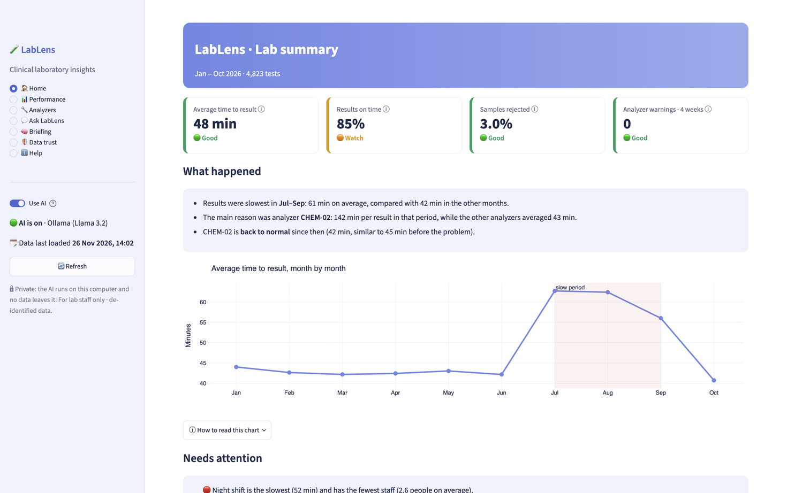
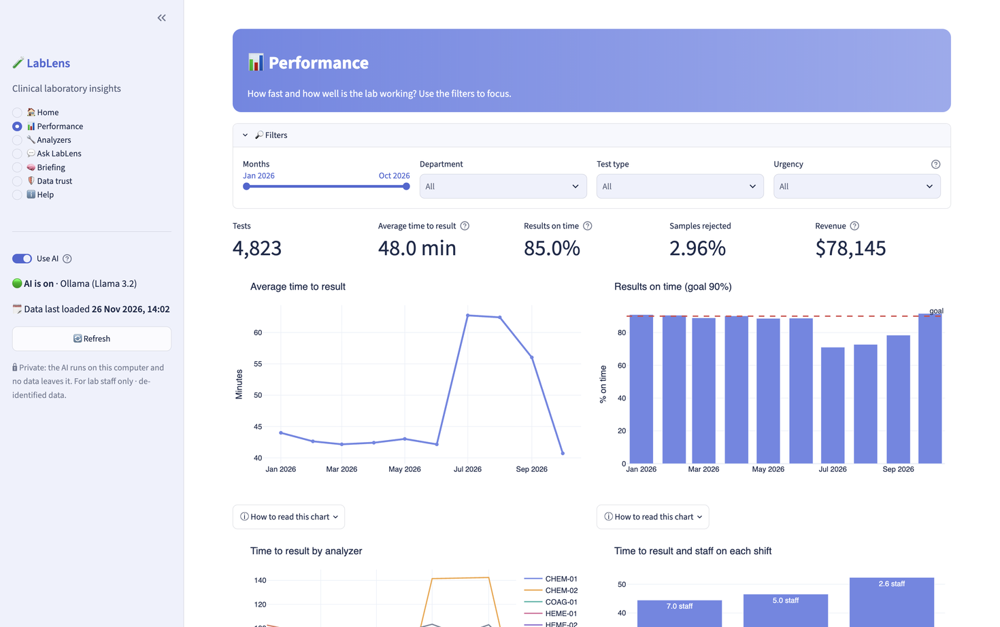
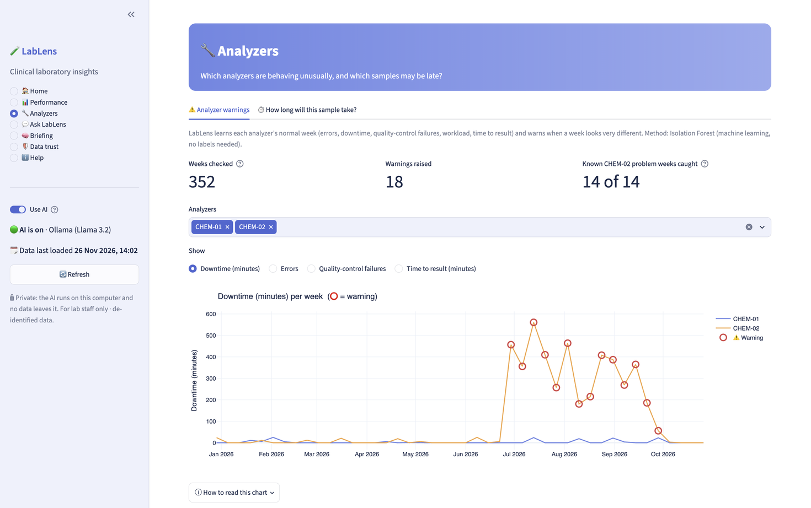

# LabLens — Clinical Laboratory Data Engineering and Analytics

Advanced Database capstone project · Prasanthi Arikonda · UT Dallas · November 2026

LabLens is an internal decision-support tool for clinical laboratory staff. It combines an operational
MySQL database, MongoDB documents, an Excel fee schedule and a CSV staffing roster into one PostgreSQL
warehouse, adds two machine-learning models, and lets staff ask questions in plain English through a
local Llama model, with safety checks, source citations and an audit log.

> All data is **synthetic and de-identified** (no patient names). It contains a planted, documented
> incident: chemistry analyzer **CHEM-02** failed in Jul–Sep 2026 and was repaired on 30 Sep 2026.

### Screenshots

**Home: the lab's story at a glance.** Key numbers, what happened, and the slow period caused by CHEM-02.



**Performance: warehouse-powered dashboard with filters.**



**Analyzers: machine-learning warnings (Isolation Forest).** All 14 known CHEM-02 problem weeks were flagged.



A slide deck with the full project story is in [`docs/LabLens-Presentation.pdf`](docs/LabLens-Presentation.pdf).

### Key results

| Area | Result |
|---|---|
| ETL data quality | 262 data problems fixed with 8 cleaning rules; 4,826 tests in MySQL = 4,826 in the warehouse; 0 duplicates after 7 loads |
| Warehouse performance | Query time cut from 5.1 ms to 2.1 ms |
| Late-result model (Random Forest) | ROC-AUC 0.90, versus 0.87 for a logistic-regression baseline |
| Analyzer warnings (Isolation Forest) | 14 of 14 known problem weeks caught, with no labels needed |
| Testing | 58 of 60 automated tests passed; 19 of 19 AI safety tests passed |

---

## 1. Architecture

```
 MySQL (clinical_lab_ops)          MongoDB (clinical_lab_docs)        Files (data/external)
 orders, samples, results,         sample tracking, analyzer logs,    payer_fee_schedule.xlsx
 tests, instruments, patients      incident reports, policies/SOPs    lab_staffing_roster.csv
            \                                   |                                /
             \______________  Python ETL (src/etl_*.py)  _______________________/
                              extract → 8 data-quality rules → load (upserts, watermarks,
                              checksums, one transaction, reconciliation, logs)
                                                 |
                              PostgreSQL warehouse (clinical_lab_dw)
                              staging · dw (star schema) · etl (logs) · ai (RAG + audit log)
                                 /                |                        \
             Analytics & ML (notebook)    Llama via Ollama (local)     Streamlit app "LabLens"
             Model A: late-result risk    NL→SQL (validated, read-only) dashboards, AI pages,
             Model C: analyzer anomalies  RAG with pgvector, briefing   data trust, fallback mode
```

## 2. Project structure

```
adv_capstone_project/
├── README.md                     this guide
├── requirements.txt              exact Python package versions
├── .env.example                  configuration template (copy to .env)
├── .streamlit/config.toml        LabLens colour theme
├── mysql/
│   ├── 01_mysql_clinical_lab.sql     schema, functions, triggers, procedures, sample data
│   └── 02_mysql_queries_and_demos.sql views, analytical queries, demos
├── postgres/
│   ├── 03_postgres_warehouse_ddl.sql staging/dw/etl schemas, star schema, read-only AI role
│   ├── 04_postgres_business_queries.sql business queries + index performance comparison
│   └── 05_ai_layer.sql               pgvector, AI views, RAG table, AI audit log
├── src/
│   ├── connectors.py             database connections (reads .env)
│   ├── mysql_python_demo.py      Python ↔ MySQL demo
│   ├── mongo_load_data.py        loads the 4 MongoDB collections
│   ├── mongo_crud_and_aggregations.py  CRUD, indexes, aggregation pipelines
│   ├── generate_external_files.py      creates the Excel and CSV source files
│   ├── etl_extract.py / etl_transform.py / etl_load.py / etl_pipeline.py   the ETL
│   ├── analytics.py              KPIs and the two ML models
│   ├── llm.py                    Ollama chat + embeddings
│   ├── sql_safety.py             SQL validator (read-only, approved views, limits)
│   ├── nl2sql.py                 English → SQL → validated, read-only execution
│   ├── rag.py                    document Q&A with pgvector
│   ├── insights.py               AI management briefing with number checking
│   └── ai_demo.py                command-line AI demo
├── notebooks/05_analytics_and_ml.ipynb   analytics, charts, Model A and Model C
├── app/streamlit_app.py          the LabLens web application
├── tests/run_tests.py            automated test suite (60 tests)
├── data/external/                generated Excel and CSV files
├── models/                       saved ML models (created by the notebook)
└── logs/                         ETL log files (created by the ETL)
```

## 3. Software and versions (tested)

| Component | Version tested |
|---|---|
| macOS on Apple Silicon | MacBook Air, 8 GB RAM |
| Python | 3.14.7 |
| MySQL (Homebrew) | client Ver 26.7.0 |
| MongoDB / mongosh | 8.3.7 / 2.9.2 |
| PostgreSQL (Homebrew) + pgvector | 17.10 |
| Ollama | 0.40.14 |
| Llama model / embedding model | `llama3.2` (3B) / `nomic-embed-text` |
| Streamlit | 1.67.0 |
| Python packages | see `requirements.txt` |

The handbook recommends 16 GB RAM. The 3B model was chosen so everything runs on 8 GB on CPU;
AI answers take about 1–20 seconds.

## 4. Installation (one time)

Run all commands in **Terminal** from the project folder unless stated otherwise.

**4.1 Install the databases and Ollama** (macOS with [Homebrew](https://brew.sh)):

```bash
brew install mysql postgresql@17 pgvector
brew tap mongodb/brew && brew install mongodb-community
brew install --cask ollama
```

**4.2 Start the services:**

```bash
brew services start mysql
brew services start mongodb-community
brew services start postgresql@17
```

Then open the **Ollama** app (Applications) and download the two models:

```bash
ollama pull llama3.2
ollama pull nomic-embed-text
```

**4.3 Create the Python environment:**

```bash
cd adv_capstone_project
python3 -m venv .venv
source .venv/bin/activate
pip install -r requirements.txt
```

Every new Terminal needs `source .venv/bin/activate` again (the prompt then starts with `(.venv)`).

**4.4 Configure:**

```bash
cp .env.example .env
```

Open `.env` and fill in your own values (see section 5). **Never share or submit `.env`.**

## 5. Configuration (`.env`)

| Setting | Meaning | Example |
|---|---|---|
| `MYSQL_HOST`, `MYSQL_PORT` | MySQL server | `localhost`, `3306` |
| `MYSQL_USER`, `MYSQL_PASSWORD` | your MySQL login | `root`, *your password* |
| `MYSQL_DATABASE` | operational database | `clinical_lab_ops` |
| `MONGO_URI`, `MONGO_DATABASE` | MongoDB server and database | `mongodb://localhost:27017`, `clinical_lab_docs` |
| `PG_HOST`, `PG_PORT`, `PG_DATABASE` | PostgreSQL warehouse | `localhost`, `5432`, `clinical_lab_dw` |
| `PG_USER`, `PG_PASSWORD` | PostgreSQL owner account | your Mac user name, empty password |
| `PG_READONLY_USER`, `PG_READONLY_PASSWORD` | read-only account used by the AI | `lab_ai_reader`, empty |
| `OLLAMA_MODEL`, `OLLAMA_EMBED_MODEL` | local AI models | `llama3.2`, `nomic-embed-text` |

## 6. Database setup and data loading (in this order)

| Step | What | Command |
|---|---|---|
| 1 | MySQL schema, routines and sample data (~15,700 rows) | In MySQL Workbench open and run `mysql/01_mysql_clinical_lab.sql` (lightning icon), or `mysql -u root -p < mysql/01_mysql_clinical_lab.sql` |
| 2 | *(optional)* MySQL views, queries, demos | Run `mysql/02_mysql_queries_and_demos.sql` in Workbench |
| 3 | MongoDB collections (needs MySQL loaded) | `python src/mongo_load_data.py` |
| 4 | MongoDB indexes + aggregation demo | `python src/mongo_crud_and_aggregations.py` |
| 5 | Excel and CSV source files | `python src/generate_external_files.py` |
| 6 | Create the warehouse database | `createdb clinical_lab_dw` |
| 7 | Warehouse schemas, star schema, read-only role | `psql -d clinical_lab_dw -f postgres/03_postgres_warehouse_ddl.sql` |
| 8 | **Full ETL load** | `python src/etl_pipeline.py --full` |
| 9 | *(optional)* business queries + index comparison | `psql -d clinical_lab_dw -f postgres/04_postgres_business_queries.sql` |
| 10 | AI layer (pgvector, AI views, audit log) | `psql -d clinical_lab_dw -f postgres/05_ai_layer.sql` |
| 11 | Analytics and ML models (creates `models/*.joblib`) | Open `notebooks/05_analytics_and_ml.ipynb` in VS Code, select the `.venv` kernel, **Run All** |
| 12 | Build the document search index (Ollama running) | `python src/ai_demo.py index` |

**Important:** step 7 deletes and recreates the warehouse. If you ever re-run it, re-run steps 8, 10 and 12.

**Later updates:** `python src/etl_pipeline.py` (without `--full`) loads only new data since the last load
(bookmarks/watermarks). It is safe to run repeatedly. The **Load new data now** button in LabLens does the same.

## 7. Running LabLens

1. Make sure MySQL, MongoDB, PostgreSQL and the **Ollama app** are running.
2. In Terminal, from the project folder:

```bash
source .venv/bin/activate
streamlit run app/streamlit_app.py
```

3. The browser opens **http://localhost:8501**. Keep the Terminal open; press **Control + C** to stop.

**Command-line AI demo** (optional):

```bash
python src/ai_demo.py sql "Which analyzer had the most downtime in quarter 3?"
python src/ai_demo.py rag "What should staff do when a chemistry analyzer shows error E-417?"
python src/ai_demo.py insight
python src/ai_demo.py safety
```

## 8. User guide (LabLens pages)

| Page | What it is for |
|---|---|
| 🏠 **Home** | The lab's situation in 15 seconds: 4 key numbers, what happened, what needs attention |
| 📊 **Performance** | All charts with filters (months, department, test type, urgency) |
| 🔧 **Analyzers** | Analyzer warnings (Isolation Forest) and "How long will this sample take?" (expected time + late-result risk) |
| 💬 **Ask LabLens** | Questions about numbers (Llama → validated read-only SQL → table + explanation) and about policies/SOPs (answers with sources) |
| 🧠 **Briefing** | AI explanation of why turnaround time got worse, with measured facts, labelled hypotheses and a number check |
| 🛡️ **Data trust** | Data checks, cleaning rules, update history, bookmarks and the AI activity log |
| ℹ️ **Help** | How LabLens works, what the colours mean, meaning of words |

- Every chart has **ⓘ How to read this chart**.
- The **Use AI** switch in the sidebar turns on *fallback mode*: charts keep working, Ask LabLens offers
  ready-made verified answers and a word search, so LabLens works even when the local AI is slow or off.
- AI answers can be wrong: always check them against the table or the sources shown underneath.

## 9. Testing

```bash
python tests/run_tests.py            # all 60 tests, about 90-100 seconds (Ollama running)
python tests/run_tests.py --no-ai    # skip the Llama tests
python tests/run_tests.py --no-etl   # skip the incremental-load test
```

Results are saved to `tests/test_results.md` and `tests/test_results.csv`; earlier runs are in
`tests/history/`. Final result: **58 of 60 passed** (the 2 failures are documented limitations of the
3B model; see the Test Report).

## 10. AI safety measures

- The AI only reads three approved views (`ai_lab_tests`, `ai_instrument_events`, `ai_staffing`), never raw patient tables.
- Every generated query is validated: SELECT only, one statement, approved views only, no dangerous functions, `LIMIT 200` added.
- Queries run with the read-only account `lab_ai_reader` (read-only transactions, 5-second timeout).
- Requests to delete, change or add data are refused before the AI is called.
- Every AI question, query and result status is logged in `ai.query_log` (shown on the Data trust page).
- RAG answers use only lab documents and show their sources; out-of-scope questions get "The documents do not contain this information."
- The briefing's numbers are written by code; any number the AI writes is checked against the facts.

## 11. Troubleshooting

| Problem | Fix |
|---|---|
| `ModuleNotFoundError` or `command not found: streamlit` | Run `source .venv/bin/activate` first |
| Sidebar says 🔴 **AI is off** | Open the Ollama app, then click **Refresh** |
| AI stays 🟢 after quitting Ollama (to test fallback) | Use the **Use AI** switch, or run `pkill -x Ollama` and `pkill -f "ollama serve"` |
| A page shows "could not load" | Check that MySQL, MongoDB and PostgreSQL are running (`brew services list`); open *Technical details* |
| `Access denied for user` (MySQL) | Check `MYSQL_USER` / `MYSQL_PASSWORD` in `.env` |
| `extension "vector" is not available` | `brew install pgvector`, then re-run `postgres/05_ai_layer.sql` |
| Delay predictor says the model file is missing | Run the notebook (`notebooks/05_analytics_and_ml.ipynb`) once |
| Document answers say nothing was found for every question | Build the index: `python src/ai_demo.py index` |
| Changes to files in `src/` don't show in LabLens | Stop LabLens (Control + C) and start it again |
| `Port 8501 is already in use` | LabLens is already running in another Terminal tab; use that one, or stop it with Control + C |
| First AI answer is slow (15–20 s) | Normal: the model loads into memory on first use |
| `IndentationError` after editing Python | Lines under `if`, `def`, `for` must be indented 4 more spaces; replace the file with the original if unsure |

## 12. Known limitations

- Synthetic data only; models are validated on synthetic data.
- The 3B model is not fully consistent (the same question can give different SQL) and RAG answers are
  sometimes incomplete; LabLens always shows the SQL, the table and the sources so users can check.
- The late-result risk is a ranking score, not a calibrated probability.
- No user accounts: LabLens runs locally for one user.

## 13. Repository note

This repository excludes `.venv/`, `__pycache__/` and `.env` (secrets). Use `.env.example` to configure.
